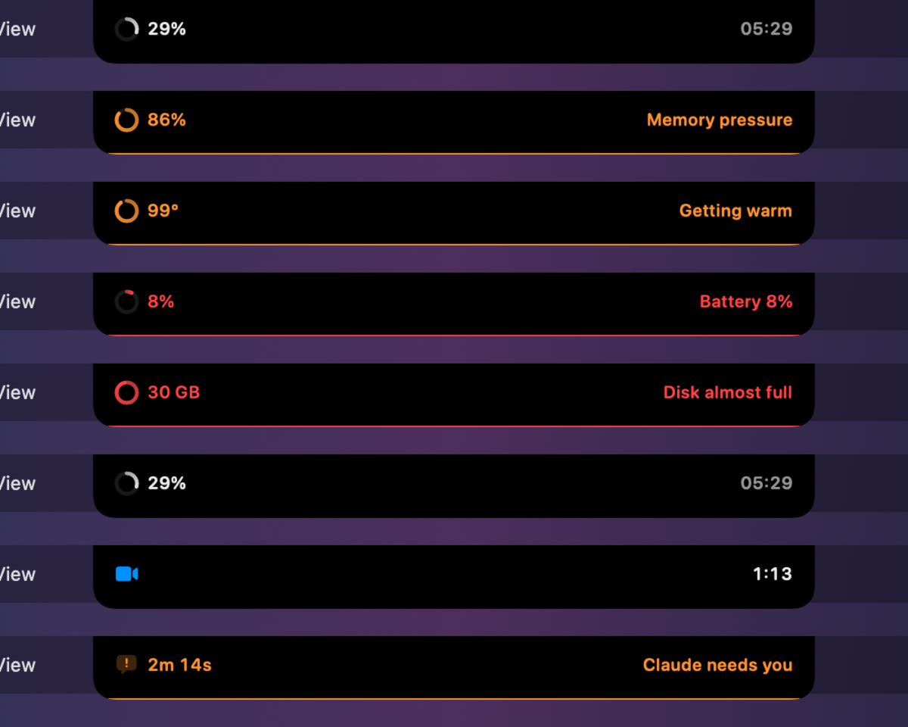
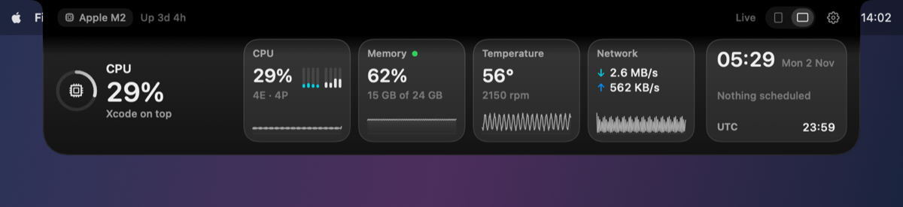
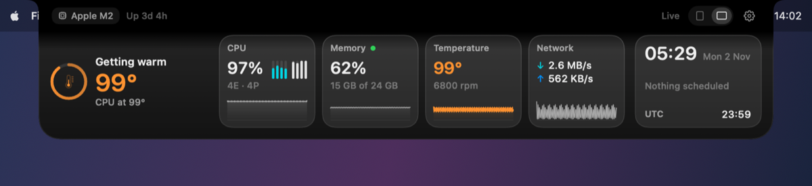
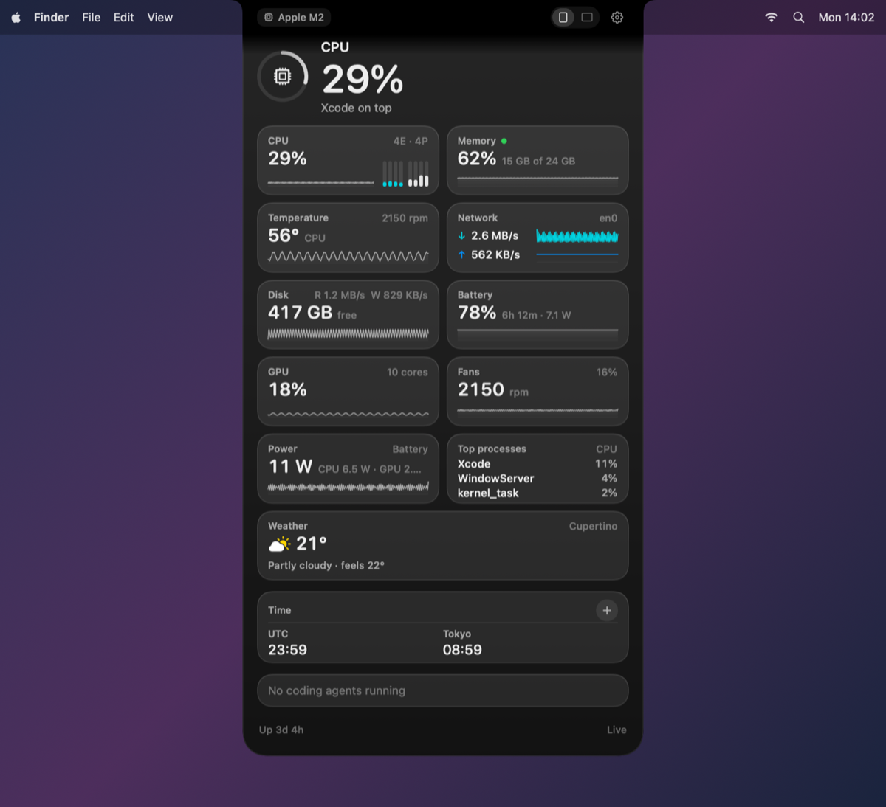
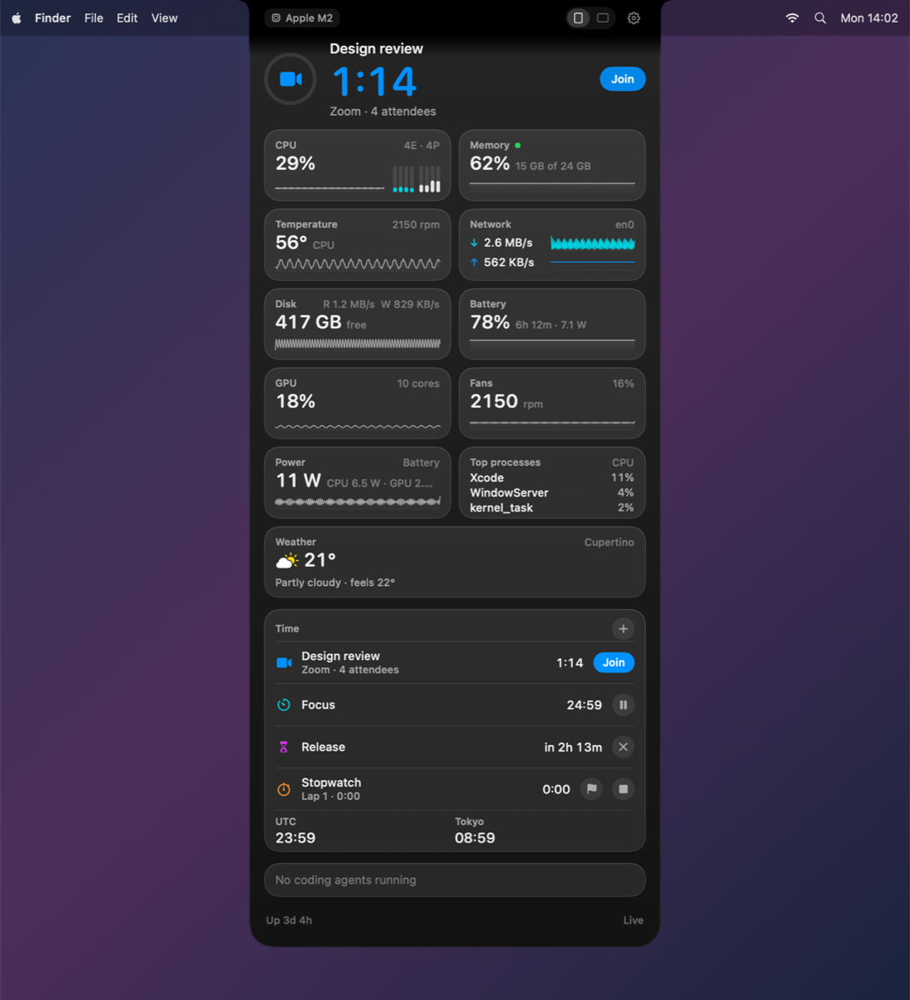

# Meridian

**One glance at your Mac.** Meridian lives in the notch of your MacBook, or in a corner of any screen, and
shows the one thing that matters right now: a CPU that has been pinned for a minute, a disk about to fill,
a battery that will not make it to your next meeting, the meeting itself, a timer in overtime, or a coding
agent waiting for you. When nothing needs you, it is a quiet clock with a thin ring of your Mac's pulse.

Open it and you get the whole picture: temperatures and fans, power in watts, per-core load, memory
pressure, disk and network rates, battery health, top processes, timers, world clocks, your next meeting
with a Join button, weather, and your Claude Code sessions.

Free, open source (MIT), no account, no telemetry, builds with the Command Line Tools alone.

<p align="center">
  
</p>

**Two ways to open it.** A tall card that unfolds from the notch, or a wide bar that sits just below it.
Switch with the toggle in the band, in Settings → General, or from the menu bar item. Both are glass by
default, with a matte black option.

<p align="center">
  
</p>
<p align="center">
  
</p>
<p align="center">
  
  &nbsp;&nbsp;
  
</p>

These are renders from the built-in snapshot tool (`swift run Meridian --snapshot`), so the glass is drawn
flat. On screen it is real Liquid Glass on macOS 26 and the ultra-thin material on Sequoia.

## Why another one

Menu bar monitors show everything all the time. Notch apps show music. Nothing shows your Mac's health
and your time in one place, decides what deserves your eye, and works on every display, notch or not.
Meridian's ranking is simple and visible: critical beats warning beats info beats calm, soonest deadline
first, and the closed surface only ever shows the top of that list.

## Install

Requires macOS 15 Sequoia or later, Apple silicon or Intel.

```bash
git clone https://github.com/Puneetspyne/Meridian.git
cd Meridian
./scripts/build-app.sh --install
```

That builds `~/Applications/Meridian.app` with the Xcode Command Line Tools (`xcode-select --install`) and
launches it. Release DMGs and a one-line installer will follow the first tagged release.

Meridian is ad-hoc signed, not notarized, so a downloaded build needs **Open Anyway** once in
System Settings → Privacy & Security. Building it yourself avoids that.

## Using it

- **Notch body**: hover the notch to peek, dwell or click to open the card. Esc or move away to close.
- **Tall or wide**: the toggle beside the gear switches between the drawer and the low bar; the card remembers it.
- **Corner body**: a quarter circle in any screen corner. Drag it to another corner, click or hold to open.
  Choose how it rests: full size, shrink until hover, or tuck into a dot that lets clicks through.
- **Menu bar**: optional item showing an icon, CPU, temperature or the most urgent signal.
- **Quick add** (⌥⌘T): `25m focus`, `6pm standup`, `every weekday 10am standup`, `sw` for a stopwatch,
  anything else becomes a to-do.
- **Settings**: Meridian menu → Settings, or ⌘, from the card.

## Built to run all day

Meridian is meant to stay open from the first coffee to the last commit, so it is measured, not hoped,
to be cheap. Release build on an M2 MacBook Air, measured with `/usr/bin/top` over 20 s windows, live data:

| State | CPU | Memory |
| --- | --- | --- |
| Closed (wings and clock) | 1.1 to 1.9 % | 16 MB |
| Open, tall card, glass | 2.0 to 2.4 % | 36 MB |
| Open, wide bar, glass | 2.1 to 2.5 % | 28 MB |

Most of the closed cost is the samplers themselves. What keeps it there: sensors are read on tiers (CPU
and memory every second, GPU and power every 2 s, temperatures and processes every 3 s), the closed wings
redraw only when their visible value changes, nothing animates once a second, and the card is not in the
view tree while it is closed. Rolling digits and per-sample ring animation were built, measured at 6 to
13 % CPU, and removed on purpose. The numbers above are from one machine; `meridianctl watch` shows yours.

## What it reads, and how

| Metric | Source | Notes |
| --- | --- | --- |
| CPU, memory, load, uptime | Mach host statistics, sysctl | Public APIs |
| GPU utilisation | IORegistry accelerator statistics | Public, undocumented keys |
| Disk space and rates | statfs, IORegistry block storage | Public |
| Network rates, IPs | getifaddrs, SystemConfiguration | Public; Wi-Fi name needs Location permission |
| Battery, cycles, health, watts | IOKit power sources, AppleSmartBattery | Public, undocumented keys |
| Temperatures | IOHIDEventSystemClient, SMC | Private, read-only, resolved at runtime |
| Fans | SMC | Read-only; no fan control yet |
| Power in watts | IOReport energy counters | Private; Apple changed access in macOS 27 |
| Next meeting | EventKit | Read-only, opt-in |
| Weather | Open-Meteo | No key, only when enabled |
| Coding agents | Claude Code hooks | Opt-in, local JSONL, removable |

Apple changes sensor keys with each chip. `meridianctl contribute` writes a JSON of your Mac's sensors so
you can open a pull request and make the next chip work for everyone. See `docs/SENSORS.md`.

## Build from source

```bash
swift build                         # everything
./scripts/test.sh                   # tests (Swift Testing from the Command Line Tools)
swift run meridianctl snapshot      # one telemetry snapshot as JSON
swift run Meridian --mock --scenario hot   # the app on fake data
swift run Meridian --snapshot docs/snapshots   # every surface rendered to PNG
```

Architecture, module ownership and the design language are in `docs/ARCHITECTURE.md` and `docs/DESIGN.md`.

## Privacy

Everything stays on your Mac. The only network calls are to Open-Meteo when you turn weather on. Calendar
access and Claude Code hooks are off until you enable them, and both can be removed from Settings.
Details in `docs/PRIVACY.md`.

## Acknowledgements

Meridian is written from scratch. It learned from [Stats](https://github.com/exelban/stats) and
[macmon](https://github.com/vladkens/macmon) (MIT) about reading Apple silicon sensors, from
[boring.notch](https://github.com/TheBoredTeam/boring.notch) and [Atoll](https://github.com/Ebullioscopic/Atoll)
(GPL-3, not copied) about living in the notch, and from [Corner](https://github.com/Tejendrasrajawat/corner)
(MIT) about a widget that shows one thing at a time.

## License

MIT. Copyright (c) 2026 Puneetspyne.
